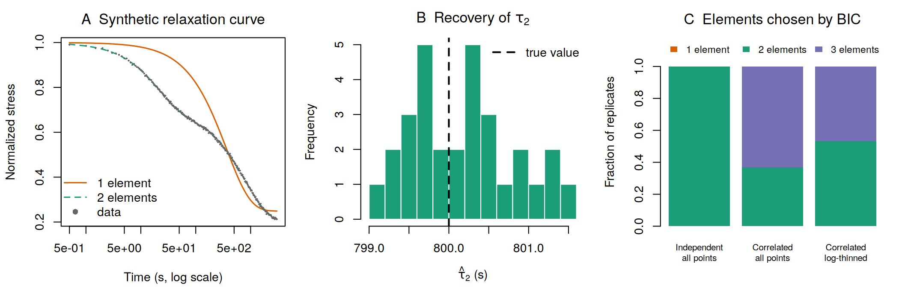

# maxwellfit

Robust fitting of generalized Maxwell models to stress-relaxation curves, with checks that tell you when a fit should not be trusted.

I wrote this for the analysis of viscoelastic stress relaxation in human fracture hematoma and engineered alginate hydrogels (Knecht et al., *Nature Communications*, under revision). The normalized stress is modelled as

```
sigma(t) = 1 - sum_i A_i * (1 - exp(-t / tau_i))
```

Multi-exponential fits are ill-conditioned: different starting values can converge to different solutions, time constants can swap labels between samples, and information criteria can reward elements that the data do not support. The package addresses each of these explicitly.

## What it does

| Problem | How it is handled |
| --- | --- |
| Local minima | 20 random starts per fit (log-uniform taus across the recorded window); the lowest-RSS solution is reported, and `starts_at_best` shows how many starts reached it |
| Taus spanning orders of magnitude | taus are fitted on the log scale with bounds; amplitudes bounded to [0, 1] |
| Label switching between samples | taus are always returned sorted, so `tau1` is the fastest process in every sample |
| Over-complex models | `compare_maxwell()` reports AIC, BIC and a nested F-test, plus residual lag-1 autocorrelation as a warning sign |
| Unphysical or unidentifiable fits | flags when `sum(A) > 1`, a tau sits at its bound, or a tau exceeds the recording time |

## Validation on synthetic data

`examples/parameter_recovery.R` simulates curves with known parameters (A = 0.3, 0.5; tau = 20, 800 s; 2 Hz for 3000 s) and checks what the fits recover.



With independent noise (SD 0.003), 30 replicates recover tau2 = 800.2 ± 0.6 s and tau1 = 20.0 ± 0.07 s, and BIC selects the correct two-element model every time (panel C, left).

Real instrument signals are not independent: after low-pass filtering, consecutive residuals are almost perfectly correlated. With autocorrelated noise of similar size, BIC chooses a spurious third element in 63% of replicates. Thinning the data to 200 log-spaced points helps only partly (47%). Information criteria computed on thousands of correlated points are therefore not sufficient evidence for model order. In practice I also check whether the extra element's time constant is reproducible across samples and whether the RMSE gain exceeds the measurement noise.

## Usage

```r
# install.packages("remotes")
remotes::install_github("Knechtrs/maxwell-relaxation-fit")
library(maxwellfit)

fit <- fit_maxwell(time, stress_norm, n_elements = 2, seed = 1)
fit
#> 2-element Maxwell fit (n = 6000 points)
#>   A1 = 0.3002   tau1 = 20.09 s
#>   A2 = 0.4999   tau2 = 800.56 s
#>   RMSE = 0.003056, R2 = 0.99948, AIC = -52451.5, BIC = -52418.0
#>   starts reaching the best solution: 18 of 19 converged

compare_maxwell(time, stress_norm, max_elements = 3, seed = 1)

# Many samples in long format (one row per time point)
fit_maxwell_by_sample(df, id = "sample", time = "time", stress = "load_norm",
                      t_max = 3000, n_elements = 2, seed = 1)
```

Preprocessing (Butterworth filtering, normalization to peak load, defining t = 0 at peak load) is done upstream and is not part of this package.

## Tests

```r
testthat::test_dir("tests/testthat")
```

The tests check parameter recovery for one- and two-element models across noise realisations, consistent tau ordering, that the reported parameters belong to the lowest-RSS start, and that BIC neither under- nor over-fits when noise is independent.

## License

MIT
